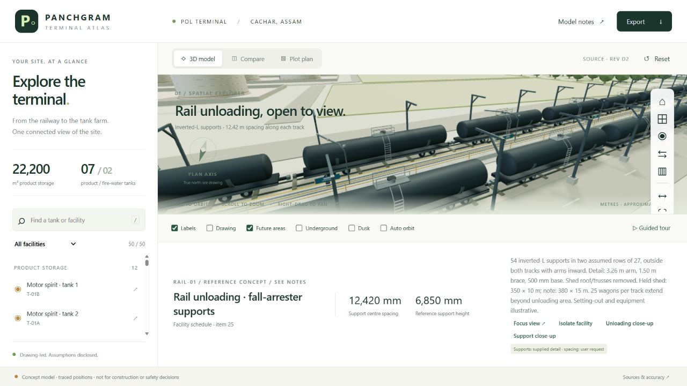
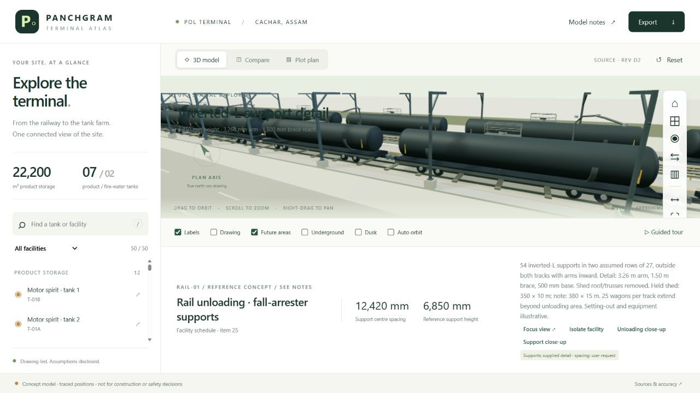
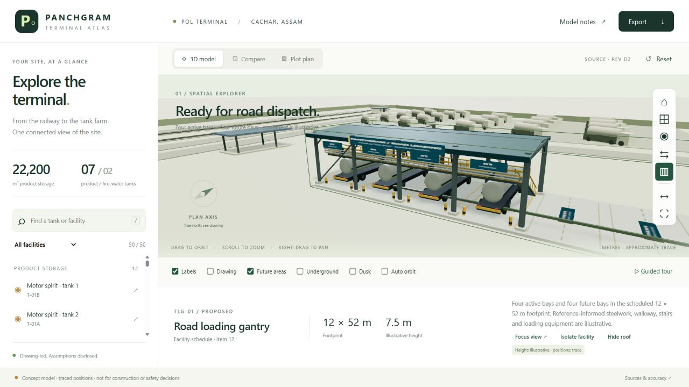
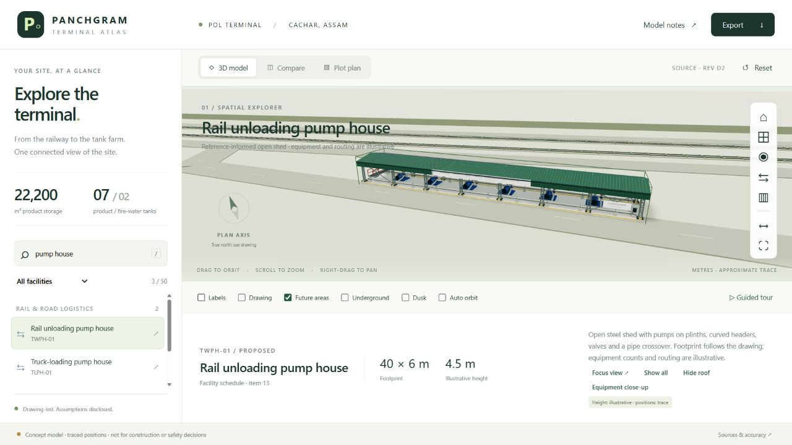
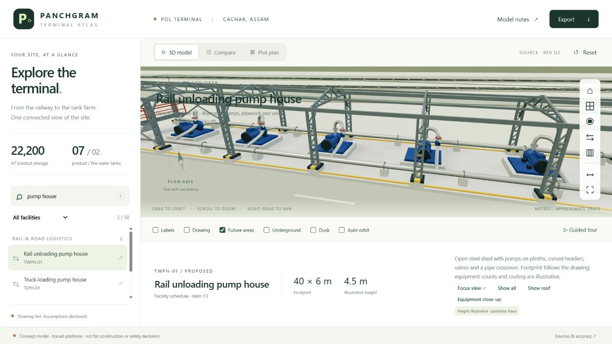
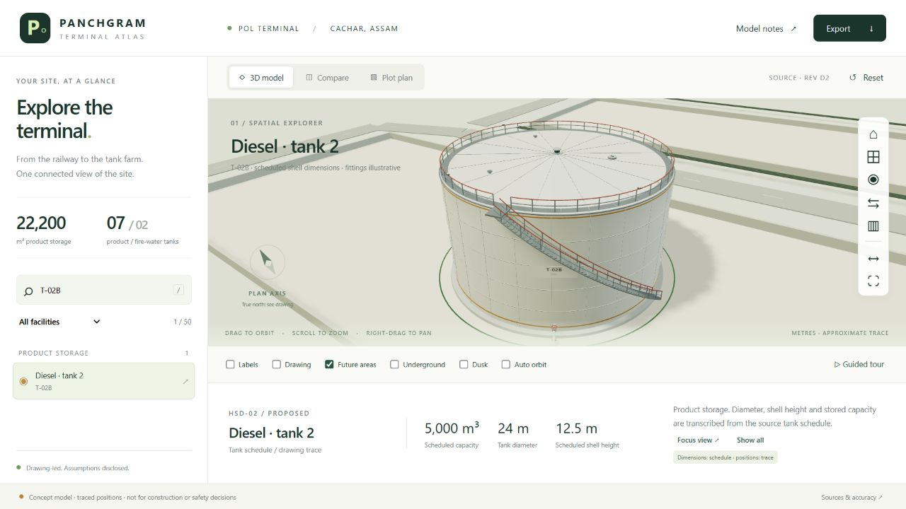
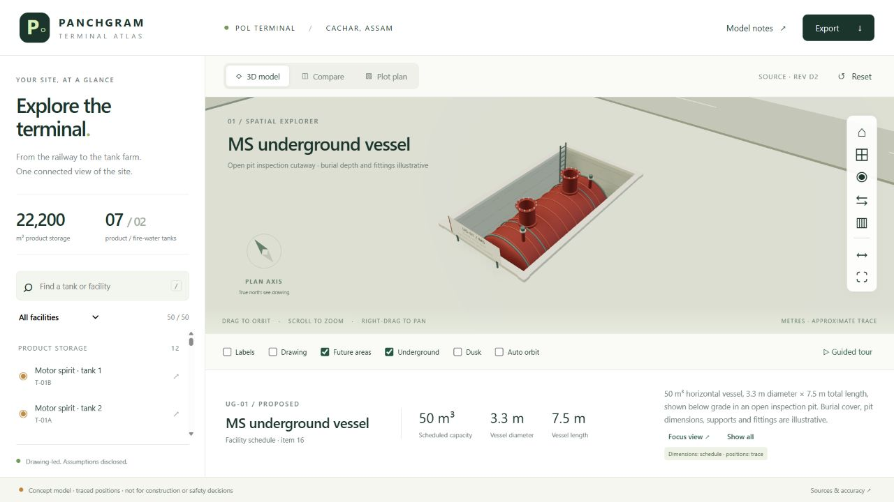
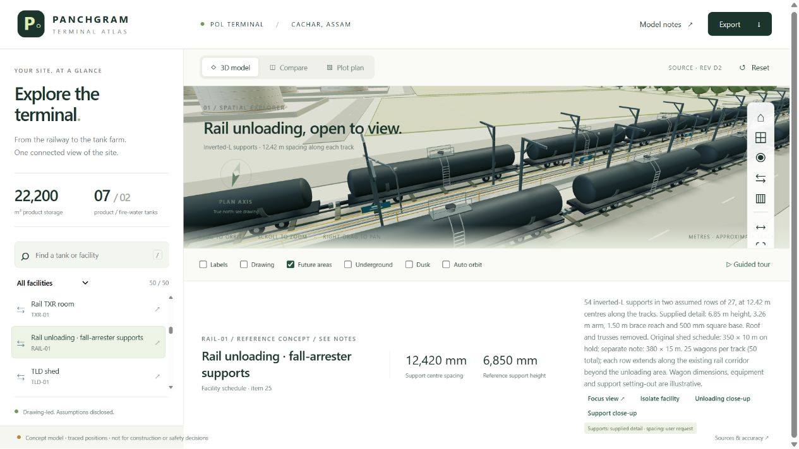
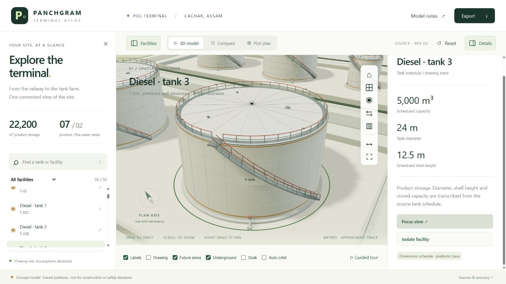
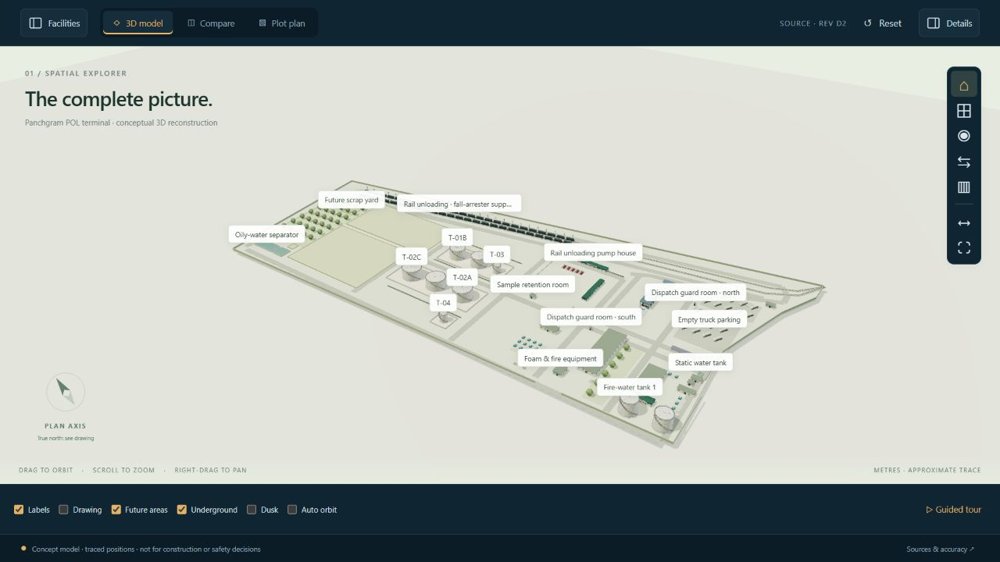

# Panchgram · Terminal Atlas

A drawing-based interactive 3D explorer for the **Panchgram POL terminal, Cachar, Assam**. Built to make layout discussions, project presentations and facility reviews easier to understand.


## What you can do

- Orbit, zoom and pan around 50 selectable facilities.
- Find equipment by facility name, model ID or source tank tag.
- Open **Facilities** for the left list and **Details** for the right information panel. Both start collapsed on a fresh visit, can be closed independently and remember your choices in this browser. The model expands into the available space.
- Inspect detailed above-ground tanks: pale shells with subtle seams, closed roofs, roof railings, curved external stairs, vents, manways, valves and source-tag identity panels. **Dusk** gives the service lights a warm glow.
- Compare the 3D scene with a linked, zoomable plot plan.
- Switch between site overview, top, tank-farm and railway views.
- Inspect three open pump houses with detailed steelwork, green cladding, pump skids, headers, valves and pipe crossovers. Select a pump house and use **Hide roof** or **Equipment close-up** for an equipment view.
- Explore the detailed loading gantry: four active tanker lanes, four future reservations, steelwork, stairs, walkway, arms and hoses. Use **Hide roof** to inspect its equipment.
- Inspect the open rail-unloading area with inverted-L fall-arrester supports at **12,420 mm centres**, outside the pair of rail tracks with arms pointing inward over the wagons. The shed roof and truss frame have been removed. Select **Rail unloading · fall-arrester supports**, then **Unloading close-up** or **Support close-up**. Wagons, platform, manifolds and hoses remain visible.
- Walk through the site's receipt, storage and dispatch journey with a six-stop guided tour.
- Isolate a facility, inspect underground vessels in open concrete pit cutaways, hide future reservations or switch to dusk lighting.
- Measure approximate horizontal ground distances.
- Export a captioned PNG image, a GLB 3D model or a CSV facility register.
- Read source notes and distinguish scheduled dimensions from illustrative heights.
- Open a facility directly using a link such as `#facility=HSD-02`.

## Source and accuracy

The source is **Panchgram_Overall Plot Plan.pdf**, drawing **KE-8S04B-PI-PPL-0001**, **Rev D2, 24 August 2026**. Its revision table states “PESO approval for construction”; this project does not independently verify approval.

The PDF contains a raster image. The accompanying DWG filename says **Rev C1** and was not parsed. This is a manually traced conceptual reconstruction from the PDF, not an automatic DWG conversion.

| Information | Basis |
|---|---|
| Product tank diameters, shell heights, stored capacities | Transcribed tank schedule |
| Scheduled building and equipment footprints | Transcribed facility schedule; orientation follows the trace |
| Positions, boundary, roads, rail lines | Manual trace, approximately calibrated to a 24 m HSD tank |
| Most building heights, roofs, fittings, vehicles, pumps | Illustrative geometry |
| Ground elevation | Flat local grade at zero; does not reproduce survey elevations |
| Pipe corridors | Schematic visual guides; not engineering routing |
| True north | See source drawing; screen compass follows drawing axes |

The **Rail TXR room (TXR-01)** has been repositioned clear of the railway and service road after owner review. Its 10 × 5 m scheduled footprint is retained. The current viewer marker follows this conceptual adjustment; `positionRevision` preserves the earlier traced position for comparison.

The **seven above-ground product tanks** total **22,200 m³**. The **two fire-water tanks** total **7,300 m³**. Five underground vessels are separately scheduled at **50 m³ each** and are excluded from the above-ground product total. These are scheduled stored capacities, not geometric cylinder volumes.

The rail-shed schedule gives **350 × 10 m**, while its superstructure hold note gives **380 × 15 m**. The source record is retained, but the owner-requested view replaces the shed superstructure with open inverted-L fall-arrester supports. Minor features such as individual watch towers, bore wells, lighting masts, potable-water tanks and the small sump are not separately reconstructed.

The five rail photos inform original geometry only; no photograph, logo or wagon number is copied into the viewer. There are **25 wagons on each track, 50 total**, as requested by the owner. Their shells are shortened to **10.45 m**, with **13.20 m centre spacing**, following the owner request to fit the allocated length. Each row occupies **330 m within the scheduled 350 m rail area**, leaving **10 m at each end**. Both rows are centred beside the unloading platform; the separate 380 m hold note remains recorded. These shorter wagons are illustrative presentation geometry. The twelve unloading stations and operator platform stay in their original area. This is not a specified rake capacity or vehicle standard. The supplied fall-arrester detail controls **6,850 mm support height**, **3,260 mm arm length**, **1,500 mm brace reach** and **500 × 500 mm base plates**. The user requested **12,420 mm spacing**, interpreted centre-to-centre along the track. Two rows of 27 supports are an assumption to interpret the detail’s **54 places**. Base elevation, member widths, fixings and placement are illustrative; safety cables, trolley/lanyard equipment and load ratings are not specified by this detail. The unloading track retains the existing local presentation alignment; this adjusts the local rendered corridor slightly while retaining the original tracing coordinates in the register. Track gauge, alignment and clearances are not surveyed or engineered.

The owner-requested column placement is **outside both tracks**, with cantilever arms reaching inward over each wagon row. The two support rows occupy the outer sides of the railway, leaving the space between the tracks free of support columns. Exact setting-out coordinates remain illustrative. **Support close-up** now views the assembly from the outside so the base is visible.





The loading-gantry update uses your supplied image only to understand common industrial features. All geometry, signs and colours are created independently; the image is not embedded in the viewer. The plot plan still controls the **12 × 52 m** footprint and **four active + four future** bay count. Product assignments, platform height and loading-equipment details are illustrative. The GitHub-ready ZIP excludes the local reference PNG.



**Use this viewer for presentations and layout communication. Do not use its measurements for construction, quantities, safety clearances or statutory decisions.**

The three pump houses now use your supplied photographs as reference only. Their scheduled footprints remain **24 × 8 m** (fire water), **40 × 6 m** (rail unloading) and **6 × 45 m** (truck loading). Pump counts, drivers and routing are illustrative. The viewer does not embed the photographs; packaging excludes the local `Photos/` folder.





The tank-farm update uses **TankStorage-1920x840.jpg** as reference only. Original geometry and a generated paint texture improve all nine above-ground tanks. Scheduled diameters, shell heights, capacities and roof-type tags are preserved. The photo is excluded from the viewer and GitHub package. Roof slopes, stair/access details, paint, foundations, nozzles and lights are illustrative. Internal floating roof tanks retain closed outer roofs.



The underground-vessel update uses **UG Vessel.jpg** as reference only. Five original red-coated horizontal vessels have rounded ends, raised access necks, bolted rims, weld lines, saddle supports, pit ladders and identity signs. They sit below grade in inspection cutaways; turning **Underground** off restores the terrain. **3.3 m diameter × 7.5 m total length × 50 m³ scheduled capacity** is preserved for each vessel. Soil cover, pit dimensions, heads, coating, supports and fittings are illustrative. The photograph is excluded from the viewer and GitHub package.



## Prerequisites

For viewing a published website: a modern browser with hardware-accelerated 3D graphics (WebGL). No account or API key is required for visitors.

For local viewing: **Node.js 20 or newer**, or Python 3 as an alternative. The supplied Windows launcher also recognises the bundled Codex Node runtime on this computer. No package installation is necessary; Three.js 0.180.0 is bundled locally under `vendor/`.

For publishing: a GitHub account and a repository with GitHub Pages available. The most straightforward path is a public repository. Public publishing makes the included drawing images visible to anyone; decide whether that is the intended audience before uploading.

## Start on Windows

1. Extract the ZIP if using the packaged copy.
2. Open the project folder.
3. Double-click **START-PANCHGRAM.cmd**.
4. Keep the server window open. If the browser opens before the server starts, refresh once.

Or copy these commands into PowerShell on the original computer:

```powershell
cd 'E:\Old Desktop Backup\E drive\EED_2025\Cost Estimation\Codex\PDF to 3D\Panchgram plot plan\panchgram-3d'
node server.mjs
```

Open **http://127.0.0.1:4173**. Press `Ctrl+C` in the server window when finished.

If `node` is unavailable but Python is installed:

```powershell
python -m http.server 4173 --bind 127.0.0.1
```

Do not open `index.html` by double-clicking it. Browser security requires the local web server for loading the model data and JavaScript modules.

## Upload to GitHub and make it live

The simplest option needs no command-line Git and no build step.

1. In GitHub, create an empty repository, for example **panchgram-terminal-3d**.
2. Select **Add file → Upload files**.
3. Upload the **contents of this project folder**, not the ZIP and not an extra enclosing folder. `index.html` must be at the repository root. Include `src`, `data`, `vendor`, `assets`, `styles.css` and the other project files.
4. Commit the uploaded files to `main`.
5. Open **Settings → Pages**.
6. Under **Build and deployment**, choose **Deploy from a branch**.
7. Choose **main**, select **/(root)**, and save.
8. Wait for GitHub's Pages deployment to finish. Use the website link shown in Settings → Pages.

For that suggested repository name under your account, the expected address is `https://medinikb.github.io/panchgram-terminal-3d/`. This is an expected address, not a claim that this package is already published.

All website paths are relative, so the viewer supports both a repository subfolder and a custom domain. See [GitHub's official Pages instructions](https://docs.github.com/en/pages/getting-started-with-github-pages/creating-a-github-pages-site).

An optional automated deployment example is in `deployment-examples/pages.yml`. To use it instead, move it to `.github/workflows/pages.yml`, choose **GitHub Actions** in Pages settings, and run the workflow. It checks the source register before publishing. Choose either branch publishing or the Actions workflow.

## How to test the product

1. Open the site and confirm the 3D overview loads.
2. Select **Diesel · tank 2**. Confirm **5,000 m³**, **24 m diameter**, and **12.5 m shell height**.
3. Select **Compare**, click a drawing marker, and check that the facility details change.
4. Search for **T-02B**. Confirm that the same diesel tank appears.
5. Use **Isolate facility**, then **Show all**.
6. **Underground** is selected by default, like **Labels**. Inspect a vessel, or turn Underground off to hide the vessels and close their inspection pits. Its dimensions are **3.3 m diameter × 7.5 m total length**, and capacity is **50 m³**. The model now shows it below grade in an open pit; pit depth is illustrative.
7. Use **Guided tour** and complete all six stops.
8. Select **Top view**, hide labels if they obstruct your clicks, and use the double-arrow measurement control to choose two ground points. Confirm an approximate distance appears. Dragging should not create a measurement.
9. Toggle **Drawing**, **Dusk**, **Future areas** and **Auto orbit**.
10. Export an image, a 3D model and the facility register. The image includes an accuracy caption; the CSV includes confidence fields.
11. Resize the browser to phone width. Use the menu button to open the facility list.
12. Open **Model notes** and **Full sheet**. Check that the source revision is D2 and its date is 24 August 2026.
13. Select **Road loading gantry**, or use the gantry camera button. Check the four tankers and four reserved bays; use **Hide roof / Show roof** to inspect the equipment. Reset restores the roof.

14. Search for **pump house**, inspect all three facilities, and use **Hide roof / Show roof**. Use **Equipment close-up** to inspect motors, pump bodies, curved connections and valves; this hides the roof automatically. Roof visibility is remembered separately for each pump house. Reset restores all roofs. Check that selecting the truck-loading house frames its long axis correctly.

15. Select **Diesel · tank 2**, use **Focus view** and **Isolate facility**, and check the stairs, roof railings, source tag T-02B and shell seams. Confirm 24 m diameter, 12.5 m shell height and 5,000 m³. Toggle **Dusk** to see the warm light accents, then **Show all** and **Tank farm view**. Motor spirit tanks retain closed outer roofs.

16. Turn **Drawing** off for a clear equipment view. Search **UG-01**, inspect the red horizontal vessel and open manways, then use **Isolate facility**. Turn **Underground** off and confirm the pit closes. **Focus view** reopens inspection. Use **Show all** to inspect all five vessels; their combined scheduled capacity remains 250 m³, separate from the 22,200 m³ product-tank total. The exported underground inspection file includes all five only when they are visible and no facility is isolated.

17. Search **RAIL-01**, select the fall-arrester facility and confirm **12,420 mm** centre spacing and **6,850 mm** reference height. Use **Support close-up** to inspect the arm, diagonal brace and base from outside the railway; use **Unloading close-up** to see both tracks. Confirm both column rows and their pedestals stand outside the pair of tracks, with the arms pointing inward over their respective wagons. Confirm that the old roof, paired shed columns and pitched trusses are absent. Test **Isolate facility / Show all**, then **Focus view** for the entire corridor. Original shed dimensions and the hold note remain in the source description; other buildings still retain their own roofs.

Automated data and measurement checks:

```powershell
node --test tests/*.test.mjs
```

If Python 3 is installed, you can verify both packaged full-site 3D exports:

```powershell
python scripts/verify-model.py
python scripts/verify-model.py panchgram-underground-inspection.glb
```

These checks target the complete packaged models, rather than isolated-facility exports.

No compilation or build command is needed. The project is served exactly as it is stored.

## What each file does

| File or folder | Purpose |
|---|---|
| `index.html` | The page structure: facility explorer, model, drawing, controls and dialogs |
| `styles.css` | Colours, layout, responsive behaviour and readable details |
| `data/site.json` | Editable facility register, geometry dimensions, tracing coordinates, source notes and tour stops |
| `src/data.js` | Checks the register, calculates totals, searches facilities and formats CSV exports |
| `src/scene.js` | Builds the 3D geometry, camera, lighting, selection and measurement graphics |
| `src/underground-vessel.js` | Builds the exact vessel envelope with illustrative rounded heads, red coating, manways, supports, concrete pit and access details |
| `src/tank.js` | Builds the detailed tank shell, original paint texture, roof, stairs, railings, fittings, source-tag signs and dusk light accents |
| `src/pump-house.js` | Builds the original open shed, steel trusses, corrugated roof, pumps, valves and pipe crossover for all three pump houses |
| `src/gantry.js` | Builds the original gantry frame, walkway, stairs, tankers and loading equipment |
| `src/rail-gantry.js` | Builds the open rail-unloading area, platform, wagons, wheels, ladders, manifolds and unloading stations |
| `src/fall-arrester.js` | Builds the inverted-L steel supports, 45-degree braces, base plates and illustrative fixings from the supplied detail |
| `src/wagon-geometry.js` | Combines repeated fixed wagon parts by material so fifty detailed vehicles remain manageable to render |
| `src/rail-wagons.js` | Places 25 wagons on each existing track, checks corridor length and follows track direction |
| `src/rail-layout.js` | Calculates exact support spacing along each track, row direction and columns beside the rails |
| `src/app.js` | Connects buttons, searches, drawing markers, details, tours and exports |
| `assets/` | Derived drawing images, favicon and project preview |
| `vendor/` | Bundled Three.js and its controls/exporter; includes the upstream MIT license |
| `server.mjs` | A small local web server; it is unnecessary on GitHub Pages |
| `START-PANCHGRAM.cmd` | Windows launcher for local viewing |
| `panchgram-underground-inspection.glb` | Full-site export with all five underground vessels and open pit cutaways, in metres; pit depths are illustrative |
| `panchgram-concept-model.glb` | Verified standalone export of the default visible concept model, in metres; underground vessels are omitted |
| `tests/data.test.mjs` | Checks capacities, malformed records, calibration, measurement, search and CSV safety |
| `deployment-examples/pages.yml` | Optional GitHub Actions deployment template |
| `PRODUCT-GUIDE.md` | Product decisions, development journey, data explanation and future roadmap |
| `QA.md` | Actual verification results and practical limits |
| `scripts/verify-model.py` | Checks the packaged full-site 3D files, actual tank/vessel shell dimensions, roof tags, capacities, ground cutaway states, pump-house footprints, actual fall-arrester pitch/dimensions, absence of the old shed, and finite geometry |
| `scripts/package.py` | Rebuilds the GitHub-ready ZIP while excluding all local reference photographs and the gantry image |

## Make a maintainable change

For names, capacities, dimensions, trace positions and notes, edit `data/site.json`. JSON is a text format storing structured records; keep double quotes and do not add comments or trailing commas. Make a backup first.

- Dimensions use metres; capacities use cubic metres (m³).
- `planPositionPx` uses the 2000 × 1064 reference crop coordinates. These are image pixels, not surveyed eastings/northings.
- Keep each `id` unique. Source tags are stored separately because many navigation IDs were added for this viewer.
- Keep the source/confidence fields truthful when revising values.
- Run the tests, reload the viewer, and compare the changed facility with the drawing before publishing.

## Troubleshooting

| Problem | Likely cause | Practical fix |
|---|---|---|
| Blank page / data cannot load | `index.html` opened directly | Start the server and use its HTTP address |
| `node` is not recognised | Node not installed or not on the command path | Install Node.js LTS from [nodejs.org](https://nodejs.org/) or use Python |
| Port 4173 already in use | Another viewer server is still running | Close the previous server, or run `$env:PORT='4174'; node server.mjs` and open that port |
| 3D is unavailable | Hardware acceleration disabled or unsupported graphics | Enable browser hardware acceleration; the drawing viewer remains available |
| Drawing marker is off-screen | Plan has been panned or zoomed | Click **Fit** |
| Scene looks empty | A facility is isolated or display layers are hidden | Click **Reset**, then turn on the desired layers |
| Export does not download | Browser restrictions or interrupted graphics | Allow this site's downloads; refresh and retry |
| GitHub site gives 404 | Missing root `index.html` or deployment unfinished | Check file placement and Settings → Pages deployment status |
| Changes are not visible | Old browser cache or deploy still running | Wait for deployment, then refresh the page |

## Ownership and third-party code

The supplied drawing images retain their original ownership. Three.js is distributed under its bundled MIT license (`vendor/LICENSE`). Do not assume that using a public GitHub repository grants rights to publish the source drawing.

## Check the adjusted TXR room

Search TXR-01 → select Rail TXR room → Focus view. Confirm that the building stands on open ground beside the rail/service-road area. Use Compare to see the updated marker; its position is an owner-requested viewer correction rather than a surveyed relocation. The source dimensions and original trace are retained in data/site.json.

## Wagon count update, 1 October 2026

The rail view now carries **25 wagons per track (50 total)**. Select RAIL-01 and use Focus view to see both complete rows, or Unloading close-up to inspect individual wagons. Each row now uses shortened 10.45 m illustrative shells at 13.20 m centres, occupying 330 m within the allocated 350 m length, with 10 m end margins. The original 350 m unloading area and its twelve unloading stations are retained. Shared wagon geometry and combined fixed parts reduce download and rendering work. No new tools, login or packages are required.



### Facility details in fullscreen

Fullscreen opens with the information card collapsed behind the Facility details button. Select an object to update its information, then click Facility details to expand the card. Select another object while expanded to update it immediately; click Hide facility details to collapse it again. Every new fullscreen session starts collapsed. Exiting restores your normal-view panel choices. No additional tools or packages are required.

To check: select a tank, enter fullscreen and confirm only the Facility details button appears. Select another facility and confirm the card stays collapsed. Expand it to see the selected facility's dimensions, description and available actions, then collapse it and exit fullscreen. Fullscreen requires browser support and a button click.

### Vertical facility information panel

Open Facilities, select Diesel · tank 3, then open Details to see 5,000 m³ capacity, 24 m diameter and 12.5 m shell height stacked in the right-side panel. The description, Focus view, Isolate facility and source-confidence note follow beneath them. Long panels scroll independently. Selecting another facility updates the information without reopening a collapsed panel. Refresh an already-open viewer to load the updated layout.



### Collapsible side panels

Use the sidebar icons at either end of the viewer toolbar: **Facilities** opens or closes the left panel; **Details** opens or closes the right panel. The × inside either panel also closes it. On desktop, use either panel, both together or neither. The visible button state indicates which panels are open. Press **/** to open the facility list and focus its search box. Reset changes the model view while retaining your panel choices.

On screens up to 1050 px wide, panels open as drawers over the model, one at a time. Close them with ×, Escape or a click on the dimmed background. Choosing a facility closes the list drawer; Details stays collapsed until you open it. These drawers replace the earlier information block below the mobile viewer. Open/closed preferences are stored only in this browser; if browser storage is unavailable, the buttons still work but choices may not survive a refresh.

Test: close both panels and confirm the model fills the workspace; open each separately, then both; refresh and confirm the last choices return. Select a facility while Details is closed, then open it to check the current information. On a phone, try the close button, Escape and dimmed background. No new account, service or software is required.



### More space for the model

The top header has been removed. Open **Facilities** to find the Panchgram / Terminal Atlas branding, location, **Model notes** and **Export** in the left panel. Close either side panel to make more room for the model. The desktop viewer gains the former header's 80 pixels of height; smaller screens gain 66 pixels. No new tools or setup are needed.

To check: refresh the page, open Facilities, confirm the branding is at the top of that panel, and try Model notes and Export. Close the panel and confirm the model expands into the available space.

### Navy and gold interface theme

The non-drawing interface uses the palette from [POL Terminal Explorer](https://github.com/medinikb/POL-terminal-3d/blob/main/dist/styles.css): navy panels (#102532), darker background (#0c1c27), pale text (#d9e5ec), muted blue (#91a8b8) and gold accents (#e3b466). The palette is in `ui-theme.css`, loaded after the layout stylesheet. It covers side panels, toolbar, display controls, camera buttons, details, tours, dialogs and footer. Model geometry, materials, drawing images, plan SVG and facility labels keep their existing colours. No packages or setup are required.

To check: refresh, open Facilities and Details, select a facility, open Model notes and Export, and try the collapsible fullscreen details card. Compare the model and plot plan to confirm their colours remain unchanged.

### Left-panel scrolling

Like the reference POL Terminal Explorer, the entire Facilities panel scrolls as one area. The facility list has no separate scrollbar. The scrollbar uses the navy and muted-blue palette. Open Facilities and scroll down to Future development to check; scrolling the panel leaves the model view in place.
